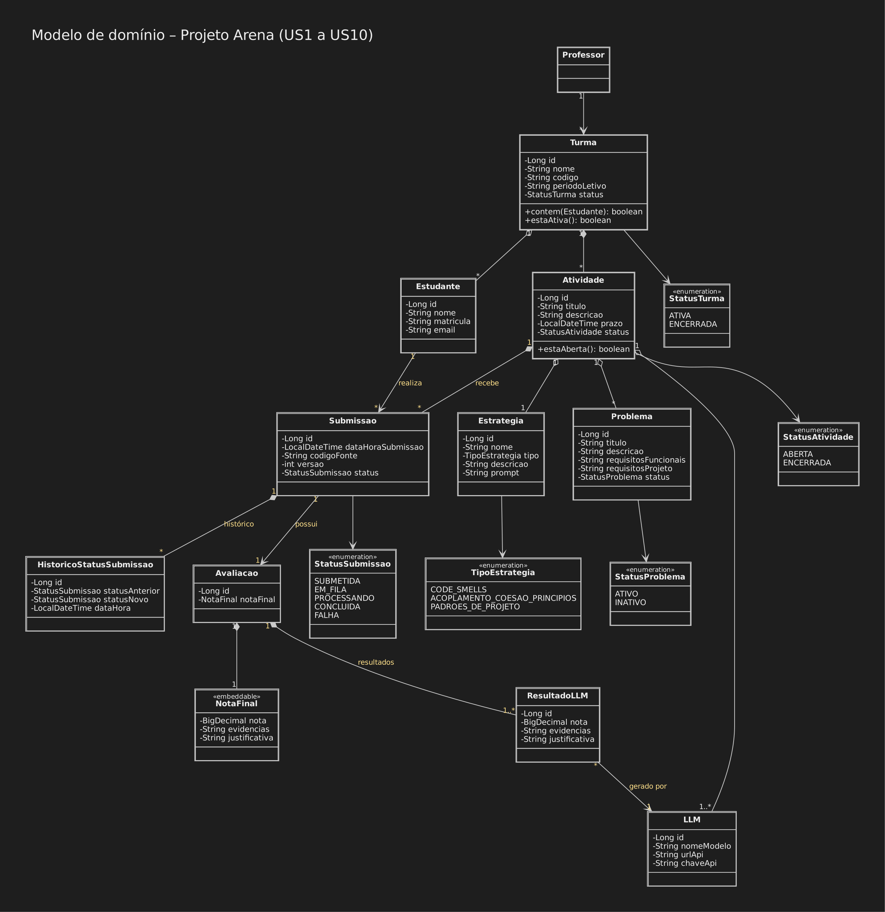

# Arena – Avaliação de Soluções de Projeto de Software

*Modelo de domínio (US1 a US10). Atributos e métodos foram deduzidos da especificação.*

---

## Sobre o projeto

O **Arena** (`br.com.psoft.arena`) é uma plataforma em que **professores** cadastram problemas de projeto de software e os disponibilizam em atividades para suas turmas, e **estudantes** submetem soluções em **Java**. Cada submissão é avaliada automaticamente por **análise estática** do código-fonte, feita por um ou mais **LLMs**, a partir dos requisitos do problema e de uma **estratégia de avaliação** definida pelo professor. O resultado é uma nota de 0 a 10, com evidências e justificativa.

## Equipe

| US | Responsável |
|----|-------------|
| US6 | Matheus Costa Chaves |
| US7 | Lucas Ricardo Silva |
| US8 | Mateus Henrique Lima Arruda |
| US9 | Erick Henrique Amorim da Silva |
| US10 | João Victor Muniz Cabral |

As US1 a US5 já estavam concluídas quando as US6 a US10 foram iniciadas.

## Funcionalidades por User Story

### US1 – Cadastro de Problemas
- Problema com título, descrição, requisitos funcionais, requisitos de projeto e status.
- Criado com status **Ativo**; o professor pode consultar, editar e desativar (**Inativo**).
- Problemas inativos não podem ser associados a novas atividades.
- Só é possível remover um problema que nunca foi usado em uma atividade.

### US2 – Cadastro de Estudantes
- Estudante com nome, matrícula e e-mail; a **matrícula** identifica o estudante de forma única.
- O professor cria, consulta e edita estudantes.

### US3 – Cadastro de Estratégias de Avaliação
- Tipos: **Code Smells**; **Baixo Acoplamento, Alta Coesão e Princípios**; **Aplicação de Padrões de Projeto**.
- Cada estratégia tem nome, tipo, descrição e **prompt de avaliação**, que o professor define e altera.
- Podem existir várias estratégias do mesmo tipo, e uma estratégia pode ser usada em várias atividades.

### US4 – Cadastro de Turmas
- Turma com nome, código, período letivo, professor responsável e status.
- Criada como **Ativa**; ao ser encerrada vira **Encerrada**, continua disponível para consulta do histórico e não recebe novos estudantes nem novas atividades.

### US5 – Associação de Estudantes às Turmas
- O professor adiciona e remove estudantes de uma turma (relação muitos-para-muitos, sem associações duplicadas).
- Somente turmas ativas recebem novas associações.
- Apenas estudantes associados à turma participam das atividades dela.

### US6 – Criação de Atividades
- Atividade associada a uma **turma ativa**, um **problema ativo**, **uma** estratégia de avaliação e um **LLM padrão**.
- O LLM é configurado com nome do modelo, URL da API (APIs públicas do Grok) e chave de acesso **armazenada de forma segura**.
- Atividade com título, descrição, prazo e status; criada como **Aberta** (aceita submissões).
- Ao ser encerrada, deixa de aceitar submissões (status final: *Concluída* na especificação, `ENCERRADA` no enum `StatusAtividade`).

### US7 – Consulta de Atividades
- O estudante vê apenas atividades das turmas das quais participa, com título, turma, problema, descrição, requisitos funcionais e de projeto, estratégia, prazo e status.
- Atividades concluídas continuam consultáveis, mas não aceitam novas submissões.

### US8 – Submissão de Soluções
- Solução enviada em **Java**, associada ao estudante, à atividade, à data/hora e ao código-fonte.
- Várias submissões por atividade são permitidas; cada nova é uma **nova versão**.
- Só estudantes da turma da atividade submetem, e só em atividades abertas.
- Após o envio, a submissão fica com status **Submetida** e o estudante é informado do recebimento.

### US9 – Acompanhamento da Submissão
- Estados: **Submetida → Em fila → Processando → Concluída** ou **Falha**.
- O estudante consulta o estado atual das suas submissões.
- Todo o histórico de mudanças de estado é registrado, e cada mudança gera uma notificação ao estudante (impressa no terminal).
- O processamento é **assíncrono**, por meio de uma **fila centralizada**.

### US10 – Avaliação da Solução
- Cada submissão tem **uma única avaliação final**, baseada nos requisitos funcionais e de projeto do problema e na estratégia da atividade.
- A avaliação é feita por **análise estática**, sem executar o código, usando o prompt definido na estratégia.
- Com múltiplos LLMs, todos avaliam a mesma submissão com as mesmas informações; o resultado de cada modelo é registrado e compõe a avaliação final.
- A avaliação concluída produz **nota de 0 a 10**, **evidências** e **justificativa**.
- Resulta em **Falha** quando não é possível concluir: um LLM não responde, a API retorna erro, há falha de comunicação ou qualquer erro que impeça um resultado válido de algum modelo.

## Decisões de projeto

- **Padrão State** para o ciclo de vida da submissão: `EstadoSubmissao` e suas implementações (`EstadoSubmetida`, `EstadoEmFila`, `EstadoProcessando`, `EstadoConcluida`, `EstadoFalha`), criadas por `EstadoSubmissaoFactory`.
- **Processamento assíncrono** com fila centralizada: `FilaSubmissao`, `SubmissaoProcessador` e `AsyncConfig`; as transições e o histórico ficam em `SubmissaoTransicaoService`.
- **Validação por interfaces**: `ValidadorSubmissao` e `ValidadorCodigoFonte` (com a implementação para Java), o que permite trocar ou estender as regras.
- **Cliente de LLM abstraído** por `LLMClient`, com `GrokClient` como implementação HTTP; `PromptBuilder` monta o prompt e `CalculadoraNotaFinal` compõe a nota final a partir dos resultados dos modelos.
- **Exceções de avaliação** com base em `AvaliacaoFalhaException` (`LLMIndisponivelException` e `RespostaLLMInvalidaException`), que levam a submissão ao estado **Falha**.
- **Segurança da chave de API** dos LLMs tratada por `CriptografiaService`.
- Arquitetura em camadas: `Controller → Service → Repository`, com DTOs de entrada e saída e classes `Model` para o domínio.

## Tecnologias

- Java
- Spring Boot e JPA/Hibernate (entidades, repositórios e injeção de dependência)
- API pública do Grok para a avaliação por LLM

## Como executar

> Preencher com os comandos de build, configuração e execução usados pelo grupo.
